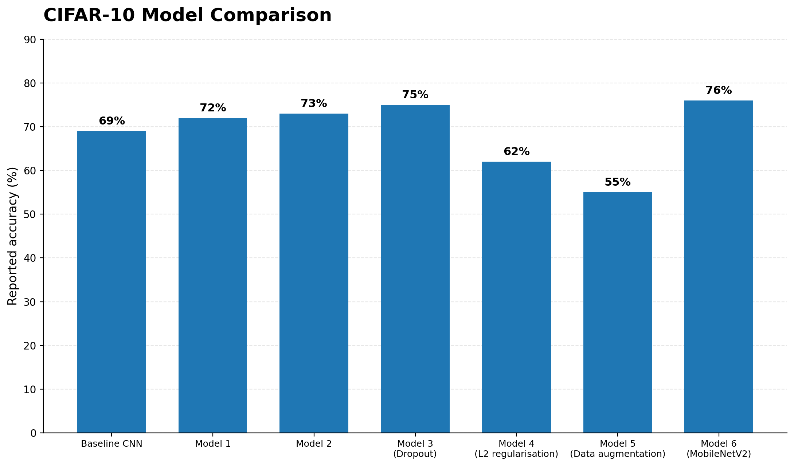

# CIFAR-10 Image Classification

A machine-learning project exploring convolutional neural networks (CNNs) for image classification using the CIFAR-10 dataset.

## Project Overview

This project investigates deep-learning approaches to classifying colour images across ten CIFAR-10 categories. The experiments explore CNN architectures, model training and validation, and MobileNetV2.

## Experiments

- **CNN/VGG:** Building and evaluating convolutional neural network models.
- **Model experimentation:** Comparing configurations and examining validation performance.
- **MobileNetV2:** Exploring a transfer-learning approach using a pre-trained image-classification architecture.

## Model Experiments and Results

I evaluated seven CIFAR-10 classification experiments, exploring changes to CNN architecture, dropout, L2 regularisation, data augmentation, and transfer learning with MobileNetV2.



### Key Findings

- **MobileNetV2 achieved the highest reported accuracy (76%)**, demonstrating the potential of transfer learning for image classification under limited computational resources.
- **Dropout reached 75% accuracy**, making it the strongest of the experiments using a modified CNN architecture.
- **L2 regularisation and data augmentation underperformed** in these experiments. The results highlighted the importance of tuning regularisation and augmentation strategies to the model and dataset.
- Increasing model depth produced modest improvements, while the pre-trained MobileNetV2 offered the strongest overall result.

*Note: The accuracy figures above follow the detailed results section of the project report. The report's summary table gives a different baseline result, so the baseline figure should be treated with that discrepancy in mind.*


## Repository Structure

```text
cifar10-image-classification/
├── README.md
├── .gitignore
├── notebooks/
│   ├── CIFAR10VGG.ipynb
│   ├── CIFAR-10.ipynb
│   └── cifar10MobileNetV2.ipynb
└── results/
    └── figures/
```

## Dataset

The project uses the CIFAR-10 dataset, containing colour images across ten classes. The dataset is not included in this repository. The notebooks use Keras or TensorFlow dataset-loading APIs.

## Tools and Technologies

- Python
- TensorFlow and Keras
- NumPy
- Matplotlib
- Convolutional neural networks
- MobileNetV2

## Results and Evaluation

The notebooks contain recorded training and validation outputs from different experiments. Training, validation and test accuracy are distinct metrics. Final test accuracy should only be reported where the corresponding evaluation output is available and verified.

## Running the Notebooks

1. Clone or download this repository.
2. Create a Python environment with the dependencies required by the chosen notebook.
3. Open a notebook in Jupyter Notebook or JupyterLab.
4. Run the cells in order and allow the dataset to be downloaded if prompted.

Dependency versions may differ from those used in the original experiments, so setup adjustments may be required.

## Project Context

This project documents machine-learning experimentation undertaken as part of a computer-science assessment, focusing on model development, experimentation and evaluation.